# Scene Archivist 1.0.0

**Your story has consequences. Your characters should remember them.**

Scene Archivist is a continuity and memory extension for **SillyTavern**, made by **Mira**. Archive scenes, give characters dated memories, condense older material, track secrets and promises, and follow a claim back to its sources.

If your characters can hide a body but cannot remember where they had dinner, we have some filing to do.

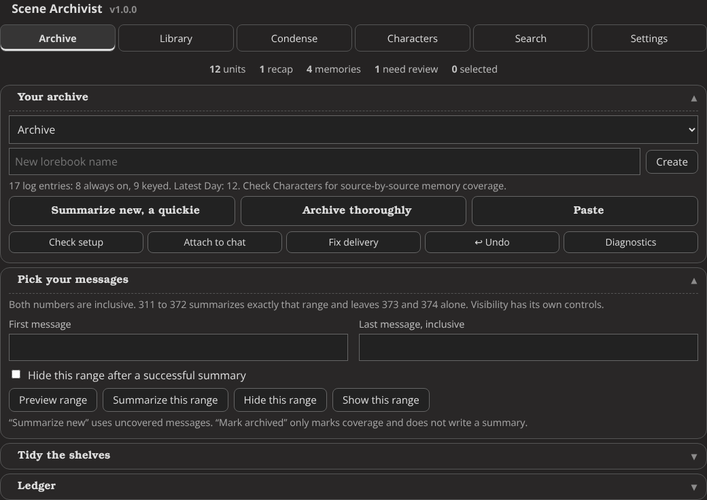

**Days, Chapters, Episodes, Sessions, Acts, Parts, Weeks, Scenes, and custom units are supported.** The examples use Days. Choose the structure your story needs.

## Start here

- [Install and make your first archive](#install-and-make-your-first-archive)
- [Find your way around](#find-your-way-around)
- [Archive exactly what you choose](#archive-exactly-what-you-choose)
- [Inspect, correct, and protect records](#inspect-correct-and-protect-records)
- [Condense older material](#condense-older-material)
- [Character memories, knowledge, and trackers](#character-memories-knowledge-and-trackers)
- [Character diaries](#character-diaries)
- [Search, continuity, and recall](#search-continuity-and-recall)
- [Settings and connections](#settings-and-connections)
- [Backups and recovery](#backups-and-recovery)
- [Slash commands](#slash-commands)
- [Troubleshooting](#troubleshooting)

### About the screenshots and videos

This guide includes **34 screenshots and three animated walkthroughs**, with MP4 versions linked beside each animation. The captures render this version's actual extension interface in a demonstration host using an invented story and scripted model replies. They show how the controls work; they are not recordings of live API calls or Mira's private chats. Your SillyTavern theme, fonts, and popup styling can look different.

Keep the **`docs/` folder beside `README.md`** when uploading or sharing the project so the media links stay intact. The extension itself does not need the documentation media to run.

## Install and make your first archive

1. Close SillyTavern or disable Scene Archivist while replacing an existing installation.
2. Extract the `Extension-SceneArchivist` folder into `public/scripts/extensions/third-party/`. Keep all the extension's JavaScript files, `style.css`, and `manifest.json` together.
3. Restart or reload SillyTavern and open a chat.
4. Open the wand menu and choose **Scene Archivist**. **Archive scene** in that menu runs a summary directly.
5. In **Archive → Your archive**, select a lorebook or enter a new name and press **Create**. Use **Check setup**, then **Attach to chat** if needed.
6. In **Settings → Prompts**, choose a prompt and its story unit. Check your delivery settings and leave **Review before writing** enabled while setting up.
7. Summarize a small range, review the result, then inspect it in **Library**. Export a complete story backup once you are happy with the setup.


## Find your way around

| Tab | What it does |
| --- | --- |
| **Archive** | Summarize new messages or an exact range, manage visibility and coverage, paste logs, tidy, and Undo. |
| **Library** | Search and select records, edit them, protect details, follow sources, inspect revisions, and rebuild stale material. |
| **Condense** | Shorten archive entries, combine them into recaps, condense character memories, and configure optional triggers. |
| **Characters** | Build and organize memories, update trackers, record knowledge and unfinished business, and write diaries. |
| **Search** | Ask with evidence, check continuity, get a return recap, configure Recall, and inspect memory loading. |
| **Settings** | Choose prompts and units, configure delivery and connections, set budgets, and manage backups. |

The counters show units, recaps, memory records, records needing review, and your current selection. A character memory record can contain many dated memories; the counter does not count every bullet. Sections collapse when you click their titles. Keyboard users can switch tabs with **Left**, **Right**, **Home**, and **End**.

<details>
<summary>See the narrow-screen layout</summary>

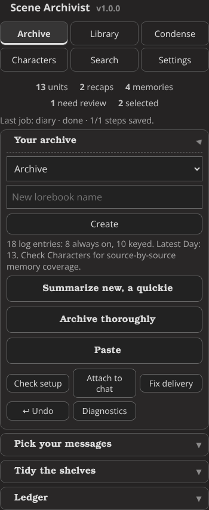

Controls wrap into a single column where needed. The same six tabs and features remain available.

</details>

## Archive exactly what you choose

### Your archive: a quickie or the full treatment

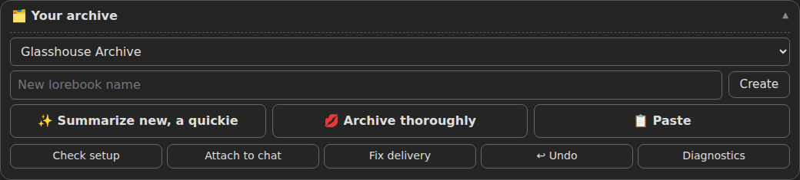

| Control | What happens |
| --- | --- |
| **Archive selector / Create** | Choose the lorebook for this story or create one. |
| **Summarize new, a quickie** | Process uncovered messages, including earlier gaps. |
| **Archive thoroughly** | Run the archive workflow and its character memory and tracker stages. Allow more requests than a quick summary. |
| **Paste** | Review and file a compatible archivist reply you generated elsewhere or wrote yourself. |
| **Check setup** | Inspect the archive setup and delivery configuration. |
| **Attach to chat** | Attach the selected archive to the open chat. |
| **Fix delivery** | Apply your configured delivery settings to managed archive entries. |
| **Undo** | Restore the last write. See [recovery](#backups-and-recovery) for scope. |
| **Diagnostics** | Copy a short setup report for troubleshooting. |

A quickie still leaves receipts. **Archive thoroughly** just has more stamina.

### Pick your messages

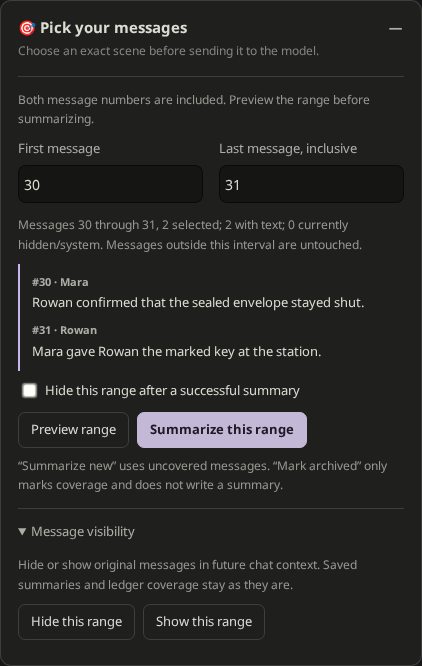

Enter the **First message** and **Last message, inclusive**, then press **Preview range**. **311 to 372 includes both 311 and 372. Messages 373 and 374 stay outside that range.** Message numbers are chat message indices, not Day or Chapter numbers.

**Summarize this range**, **Hide this range**, and **Show this range** are separate actions. Tick **Hide this range after a successful summary** if you want the selected messages hidden after the summary is accepted. Explicit range summaries use the transcript, even when the general archive mode uses the chat.

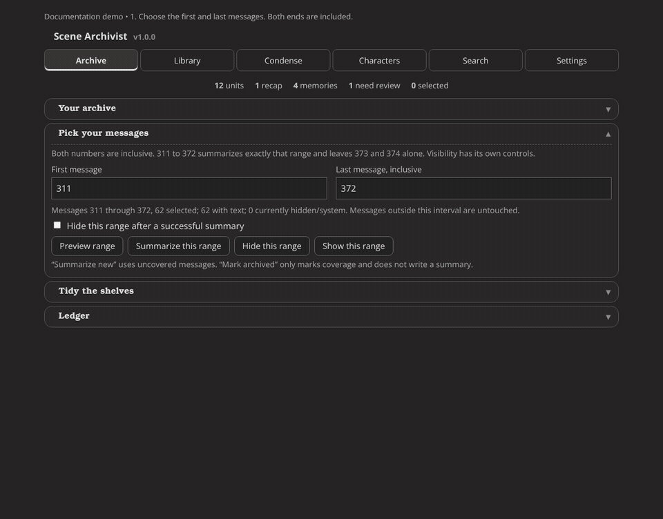

[Watch or download the exact-range walkthrough as MP4](docs/media/range-walkthrough.mp4).

### The ledger: coverage and visibility

<details>
<summary>See the ledger and its advanced controls</summary>

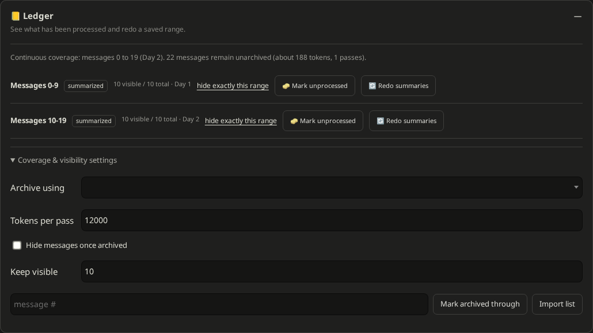

The ledger records which message ranges have been archived and shows whether their messages are actually hidden. Coverage and visibility are separate: a summarized range can remain visible, and hiding messages does not create a summary.

- **Archive using** chooses transcript passes or the chat as the model sees it. Transcript mode gives the model the selected dialogue; chat mode also uses your chat setup.
- **Tokens per pass** controls transcript chunk size.
- **Hide messages once archived** enables automatic hiding; **Keep visible** leaves the configured number of newest messages visible during normal archive runs.
- **Mark archived through** and **Import list** update coverage records. They do not generate missing summaries. Use them when reconciling an existing archive.

Normal updates skip an exact heading already in the archive. To intentionally correct an existing unit, use **Inspect / edit** or **Rebuild and review** in Library.

</details>

### Tidy the shelves

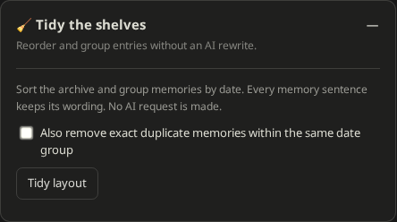

**Tidy up, hands off the prose** sorts the archive, groups character memories by date, and removes repeated keyword strings **without an AI request**. Memory sentences keep their wording. The separate checkbox also removes exact duplicate memories within the same date group. Review proposed text layout changes before saving.

This is housekeeping. Nobody asked the filing cabinet to develop a writing career.

## Inspect, correct, and protect records

### Browse the Library

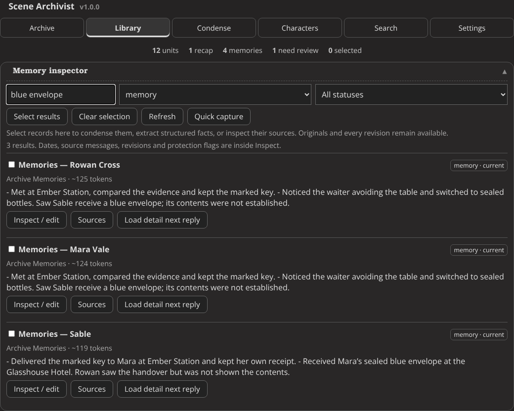

Search dates, people, places, keywords, or body text. Filter by record type and status. **Select results** selects the matching records; **Clear selection** clears the selection; **Refresh** reloads the books. Your selection feeds condensation and structured extraction in the other tabs.

Each result offers actions such as **Inspect / edit**, **Sources**, and **Load detail next reply**. Stale records also offer **Rebuild and review**. Requesting detail asks for original sources instead of their covering recap, subject to the total memory budget.

### Inspect and protect a record

<details>
<summary>See the full inspector</summary>

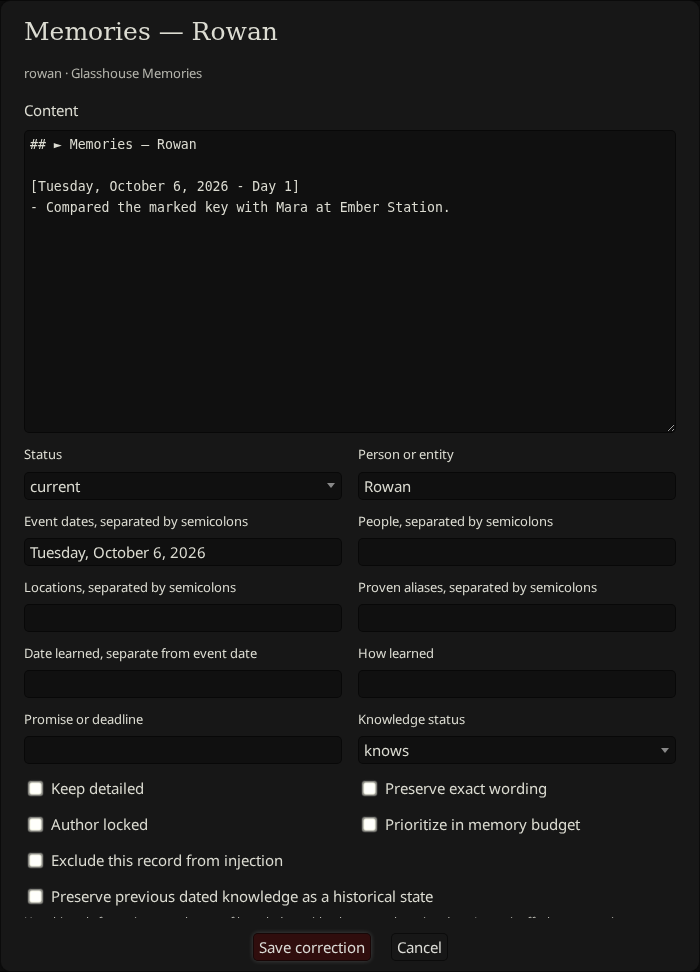

Edit the content, record status, person or entity, event dates, people, locations, proven aliases, date learned, how it was learned, deadline, and knowledge status. Use semicolons where the field asks for multiple values. Add a **Correction note** to explain the change, then save.

| Protection | Effect |
| --- | --- |
| **Keep detailed** | Exclude this record from condensation. |
| **Preserve exact wording** | Protect its wording from automated condensation and rebuilding. |
| **Author locked** | Protect the record from automated condensation and rebuilding. |
| **Prioritize in memory budget** | Give it higher loading priority. The total token cap still applies. |
| **Exclude this record from injection** | Keep it in the archive without sending it as memory context. |

**Sources and dependencies** shows provenance. **Saved revisions** keeps earlier text and metadata. Open a revision and use **Use this text in editor**, then review and save your restoration.

Some scenes deserve the full uncut version. That is what **Keep detailed** is for.

</details>

### Follow the evidence

<details>
<summary>See source entries and original message ranges</summary>

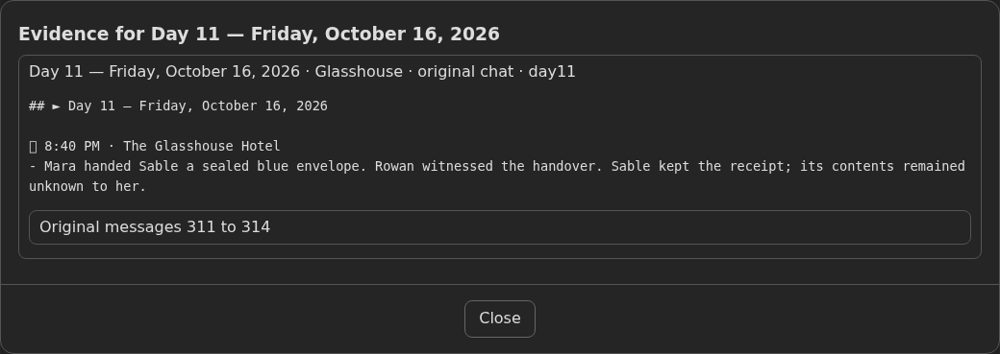

**Sources** opens linked records and their original message ranges where available. Expand a source, then its message range to inspect the dialogue behind a memory or recap. Legacy or imported records may have text without a matching transcript range.

</details>

### Quick capture

<details>
<summary>See the capture form</summary>

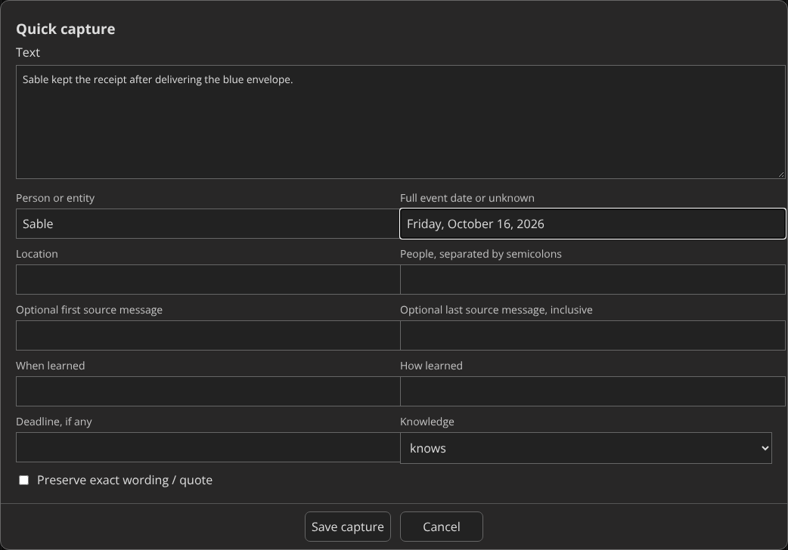

Use **Quick capture** to save a passage manually. Add its subject, event date, location, people, and optional source message bounds. Knowledge and promise fields let you record when something was learned, how it was learned, and when it is due. **Preserve exact wording** protects a passage that should stay verbatim.

</details>

### Correct stale material

<details>
<summary>See a record marked stale</summary>

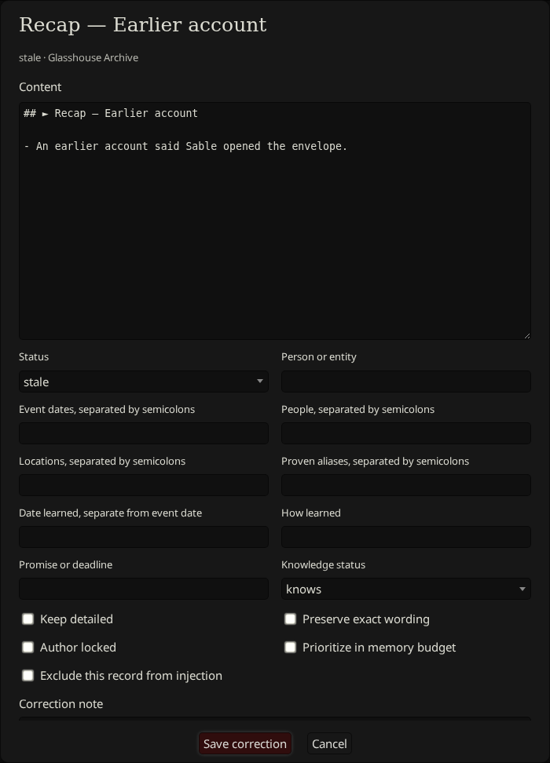

Message edits, deletions, swipes, and changes to source records can make dependent memories or recaps stale. Stale records remain inspectable and are excluded from injection.

Correct or rebuild the original unit first, then rebuild its dependent records and review each replacement. If deleting messages shifted the range boundaries, choose the intended new range yourself before rebuilding. Use **Inspect / edit** for a manual correction when a legacy record has no original source range.

</details>

## Condense older material

### Archive entries into dated recaps

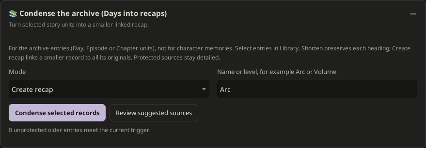

1. In **Library**, select the current, unprotected units or recaps to process.
2. Open **Condense → Condense the archive**.
3. Choose **Create recap** to combine sources, or **Shorten individual entries** to keep each heading and shorten its text.
4. For a recap, enter a name such as `Arc 1: The marked key` and select at least two eligible records per batch.
5. Press **Condense selected, gently**, review the proposed text, and save.

A new recap links to its originals, which remain in their books. Shortening saves the previous detailed text in revision history. Select existing recaps to create a broader Arc, Volume, or another level.

The preserved chronology keeps source dates, recognized times, locations, and named participants. Unknown dates stay unknown. The result must still be smaller after that chronology is included.

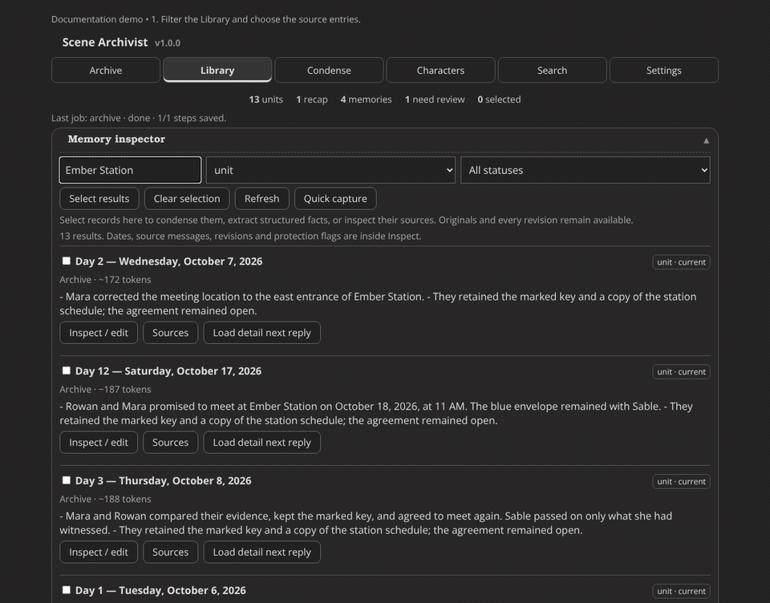

[Watch or download the recap walkthrough as MP4](docs/media/recap-walkthrough.mp4).

<details>
<summary>See the recap review</summary>

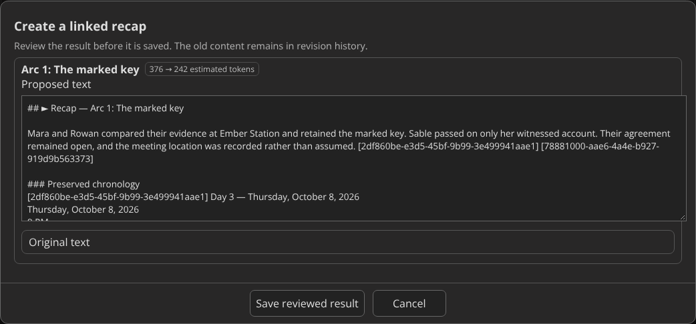

Review the proposed text and expand **Original text** to compare. The estimate shows the before-and-after size. The chronology is part of the saved recap, so scroll through the proposed text to inspect it.

</details>

### Condense character memories

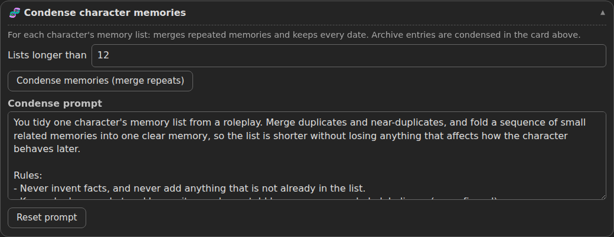

**Condense character memories** works on per-character memory lists. Set **Lists longer than**, then run the action to merge repeated memories while keeping their dates. You can edit or reset its prompt and review the proposed lists before saving.

Use archive condensation for scene records and recaps. Use memory condensation for a character's accumulated experiences. The two controls live together so you can manage both kinds of growth.

### Optional condensation triggers

<details>
<summary>See automation and trigger settings</summary>

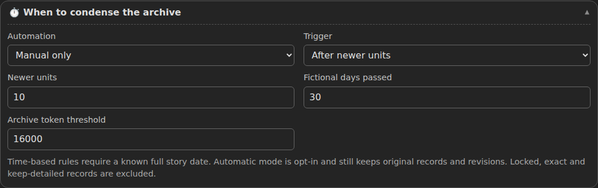

The default is **Manual only**. **Suggest and review** identifies candidates for your approval. **Automatically create recaps** is an explicit opt-in and saves eligible recaps without the manual review step.

Triggers can use the number of newer story units, fictional calendar days passed, or archive token pressure. Fictional-time rules need known, unambiguous full dates. **Review suggested sources** brings the candidates into Library for selection. Keep-detailed, exact-wording, and author-locked records are excluded from automatic condensation.

</details>

## Character memories, knowledge, and trackers

### Memories that sound like memories

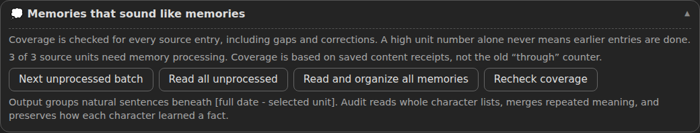

| Action | Use it for |
| --- | --- |
| **Next unprocessed batch** | Read the next uncovered sources in manageable batches. |
| **Read all unprocessed** | Process pending sources across batches, then offer a whole-list audit. |
| **Read and organize all memories** | Read complete character lists, merge repeated meaning, and preserve consequential details and knowledge differences. |
| **Recheck coverage** | Refresh source-by-source progress, including gaps and changed sources. |

Memories group readable sentences under a shared date and story unit:

```text
[Friday, October 16, 2026 - Day 11]
- Received Mara's sealed blue envelope at the Glasshouse Hotel.
- Rowan saw the handover, but she did not show him its contents.
- Kept her receipt and agreed to return to Ember Station on October 18.
```

Dates, people, places, promises, and how someone learned something belong in the memory. A unit number does not invent a calendar date: a Chapter can span several dates, and multiple units can share a date.

Coverage follows each source entry and its saved content, rather than assuming everything below the highest unit number is finished. Legacy entries without receipts can initially appear unprocessed. A whole-list audit uses staged processing for oversized lists; requests above your configured input limit stop with an explanation rather than silently discarding the rest.

### Memory settings and prompt

<details>
<summary>See destinations, batch size, range, and prompt controls</summary>

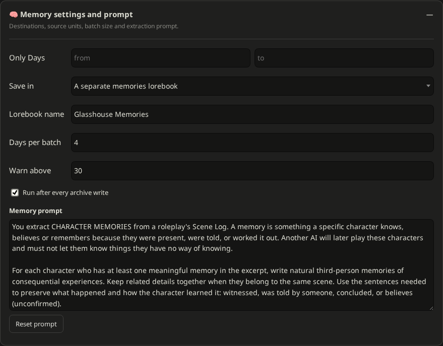

Use **Only Days** (or your chosen unit) to limit the source range. Choose a separate memories lorebook, the archive itself, or each character's own lorebook as the destination. Set the lorebook name, units per batch, and the memory-count warning threshold. **Warn above** is a warning, not a command to discard older memories.

Enable **Run after every archive write** if desired. The memory prompt is editable and can be reset. Manual controls remain in **Memories that sound like memories** above it.

</details>

### Trackers

<details>
<summary>See tracker templates and update controls</summary>

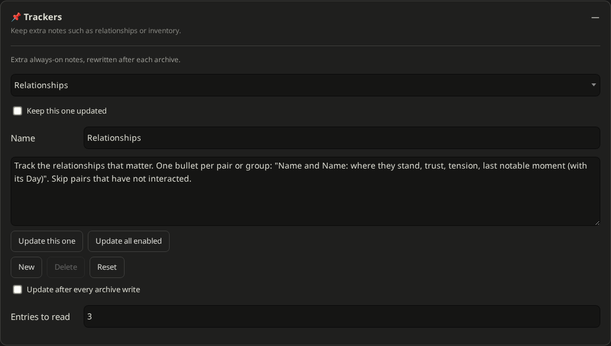

Built-in trackers cover **Relationships**, **Promises and deadlines**, **Secrets and who knows**, **Items and condition**, and **Where everyone is**. Choose one, enable it, and edit its name or prompt. Update one tracker or all enabled trackers; create, delete, or reset templates as needed.

**Entries to read** controls how many recent archive entries an update reads. **Update after every archive write** enables automatic updates. Trackers are concise current-state notes; the detailed archive remains available behind them.

Yes, there is a place to keep track of who is sleeping with whom. Also who still owes someone a key. Both have consequences.

</details>

### Facts, knowledge, and unfinished business

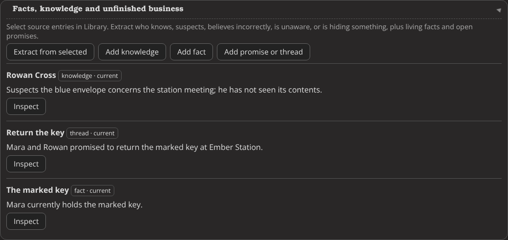

Select evidence in **Library**, then use **Extract from selected**. You can also **Add knowledge**, **Add fact**, or **Add promise or thread** manually.

Knowledge distinguishes **knows**, **suspects**, **false-belief**, **unaware**, and **hiding**. Record the event date separately from the date the character learned about it, and describe how they learned it. A fact or promise can later be resolved or superseded while keeping its earlier version inspectable.

A secret is not much of a secret if the entire cast gets telepathy by breakfast.

## Character diaries

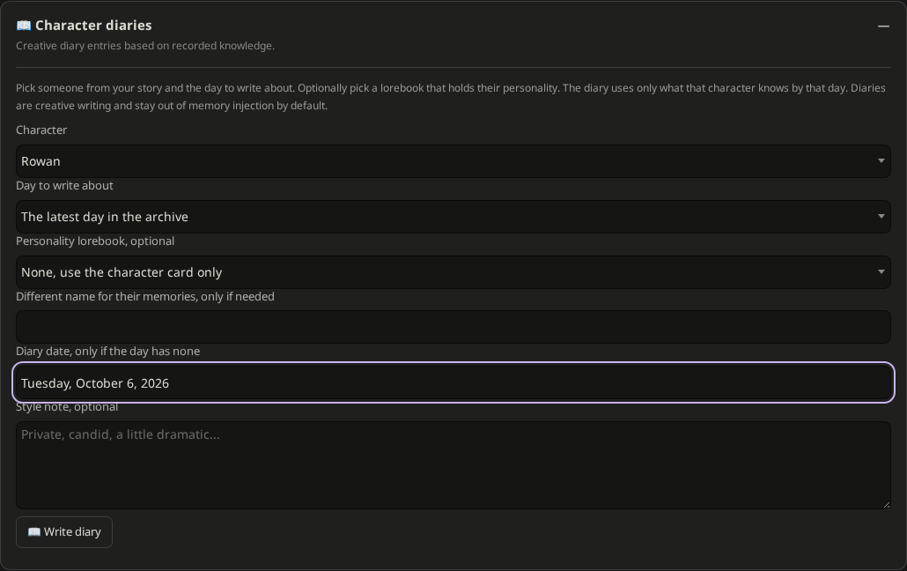

1. Create or add the character's memories first.
2. Choose a **Character**. Anyone with current memories in the archive can appear, **even without a bot card**.
3. Choose the **Day to write about**, or the latest day in the archive.
4. Optionally choose a **Personality lorebook**. Put the character's name or a proven alias in the relevant entry's title/comment or keywords so it can be matched. A matching character card can also supply their voice.
5. Use **Different name for their memories** only when needed. Supply a **Diary date** if the selected day has none, and add an optional style note.
6. Press **Write their little secrets**, review the result, and save.

The diary prompt uses that character's memories through the selected unit, with earlier memories as background. Typed **unaware** knowledge is excluded. Personality entries provide voice; the character's established memories and knowledge provide evidence.

Diaries are **imagined creative writing**. They are saved separately, marked creative, and **excluded from memory injection by default**. Saving one does not turn its invented wording into canon evidence.

Dear diary: I made another terrible decision. At least the date is correct.

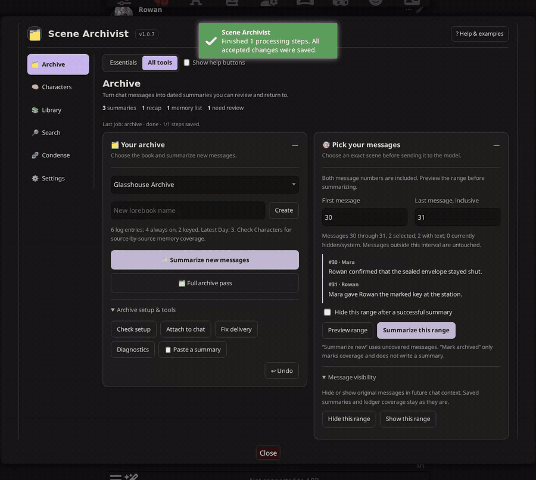

[Watch or download the diary walkthrough as MP4](docs/media/diary-walkthrough.mp4).

<details>
<summary>See the diary review and saved record</summary>

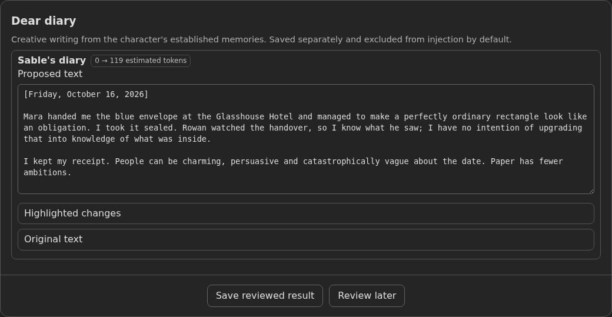

Read and edit the proposed text before accepting it.

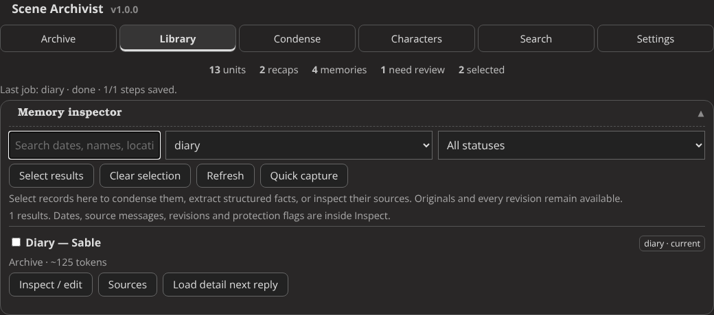

Find saved diaries using the **diary** type filter. Their injection exclusion is visible in the inspector.

</details>

## Search, continuity, and recall

### Ask with evidence or check a claim

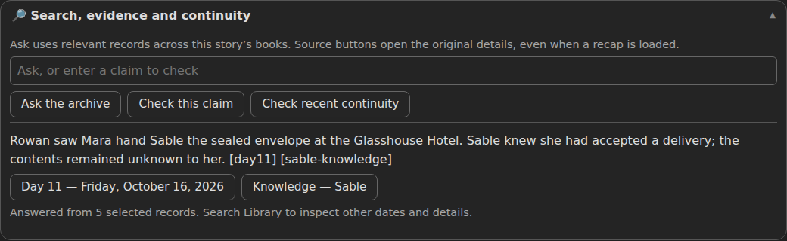

**Ask the archive** searches current records across this story's managed books and answers with source buttons. Try a specific question such as “Who received the blue envelope, and what does Rowan actually know?”

**Check this claim** compares an entered claim with archive evidence. **Check recent continuity** looks for conflicts in recent/current material. Findings can include supporting sources, conflicting sources, and suggested corrections. Apply a correction through **Inspect** when you agree; a continuity finding does not silently rewrite canon. Optional checking after new replies saves findings only.

### Previously on...

<details>
<summary>See the return-recap controls</summary>

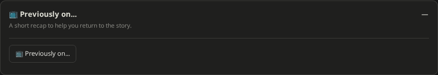

Use **Previously on...** for a short, dated return recap from recent records. **Settings → Story memory settings** can offer one after you have been away for a configured number of hours. This helps you resume a story; it does not replace the archive with a condensed record.

</details>

### Recall before a reply

<details>
<summary>See Recall settings</summary>

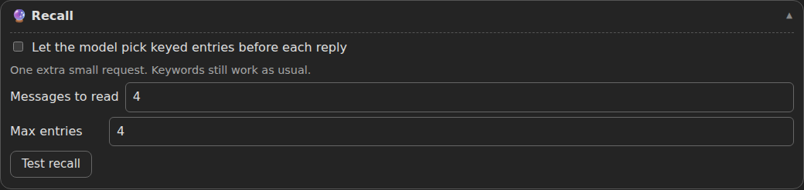

Enable **Let the model pick keyed entries before each reply** to make an additional small selection request. Choose the number of recent messages it reads and its maximum number of picks, then use **Test recall**. Ordinary keyword matching still works, and selected records remain subject to the memory budget.

</details>

### What loaded, and why?

<details>
<summary>See the budget decision and the model-context view</summary>

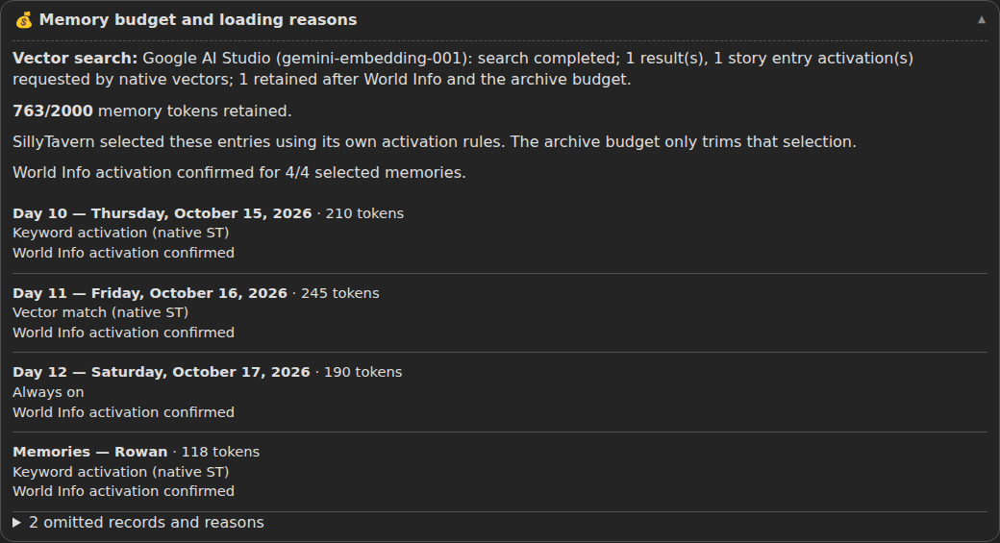

**Memory budget and loading reasons** shows selected records and why other records were omitted. Managed story books share one total content-token cap. Current facts, open threads, pins, and requested details receive priority. A covering recap and its original sources are not loaded together.

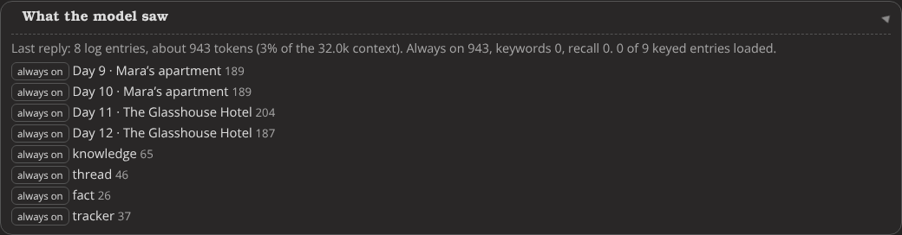

**What the model saw** shows records activated for the last observed reply, their token counts, and activation reasons. Check it alongside the budget view when a memory seems to be missing. A pin increases priority; it does not override the cap.

</details>

## Settings and connections

### Story memory settings

<details>
<summary>See budget, request limits, batch size, and return options</summary>

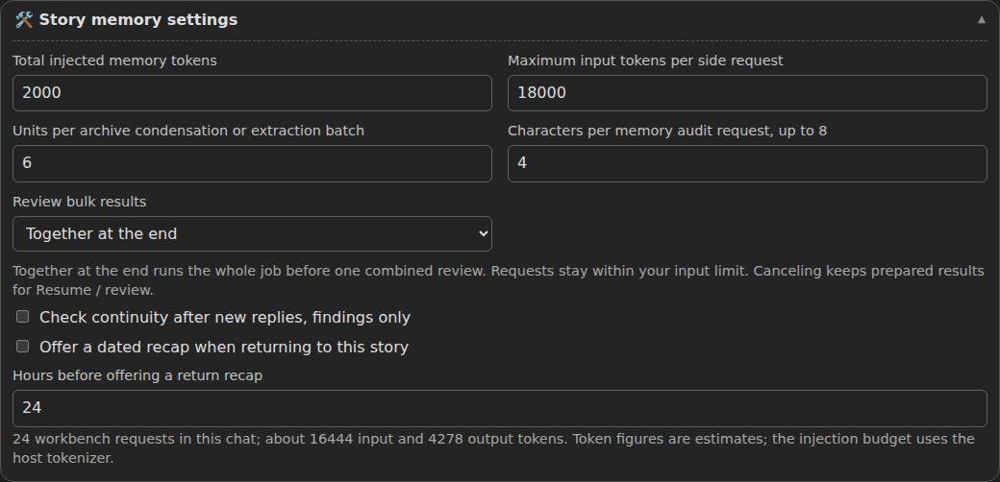

| Setting | Meaning |
| --- | --- |
| **Total injected memory tokens** | Shared cap for managed memory content sent into a chat reply. |
| **Maximum input tokens per side request** | Input limit for workbench requests. Oversized inputs stop with an explanation. |
| **Units per memory or condensation batch** | Group size for those workbench jobs. |
| **Check continuity after new replies** | Save continuity findings automatically. |
| **Offer a dated recap when returning** | Offer a return recap after the configured hours away. |

The request meter estimates workbench request counts and input/output tokens. It is not a provider bill or a complete accounting of every SillyTavern request. Archive, output, and memory limits serve different purposes.

</details>

### Delivery

<details>
<summary>See where the archive is inserted</summary>

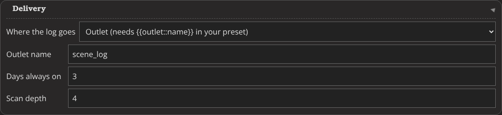

Choose **In the chat, at a depth**, **Before character definitions**, **After character definitions**, or **Outlet**. Depth mode exposes depth and role. Outlet mode needs a matching `{{outlet::name}}` in your preset and the same outlet name here.

**Days always on** (or your chosen unit) sets how many recent units stay eligible as always-on archive material. **Scan depth** controls keyword scanning. The shared memory budget still applies. Use **Archive → Fix delivery** after changing the configuration when existing managed entries need updating.

</details>

### Prompts and story units

<details>
<summary>See prompt management and custom units</summary>

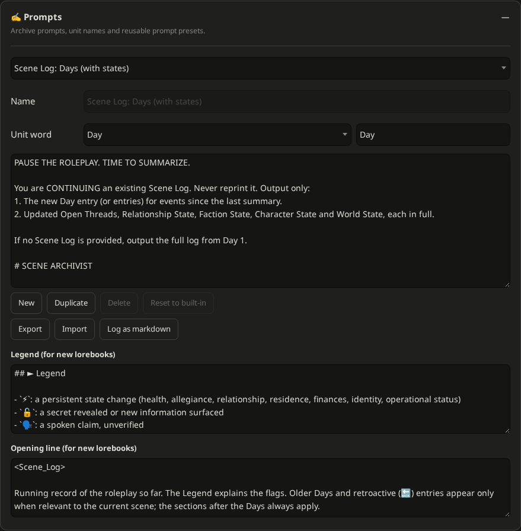

Choose a built-in prompt for Days, Episodes, Chapters, Sessions, or light key events. Each prompt keeps its own unit setting. You can create, duplicate, rename, delete, reset, import, or export prompts. **Custom unit...** lets you supply another singular label, such as `Volume`.

Keep the structured heading format when editing prompts so the parser can identify entries. **Legend** and **Opening line** supply text for newly created lorebooks. **Log as markdown** exports a readable copy of the log; a complete story backup preserves more metadata.

</details>

### Connections and the More section

<details>
<summary>See connection selection and other options</summary>

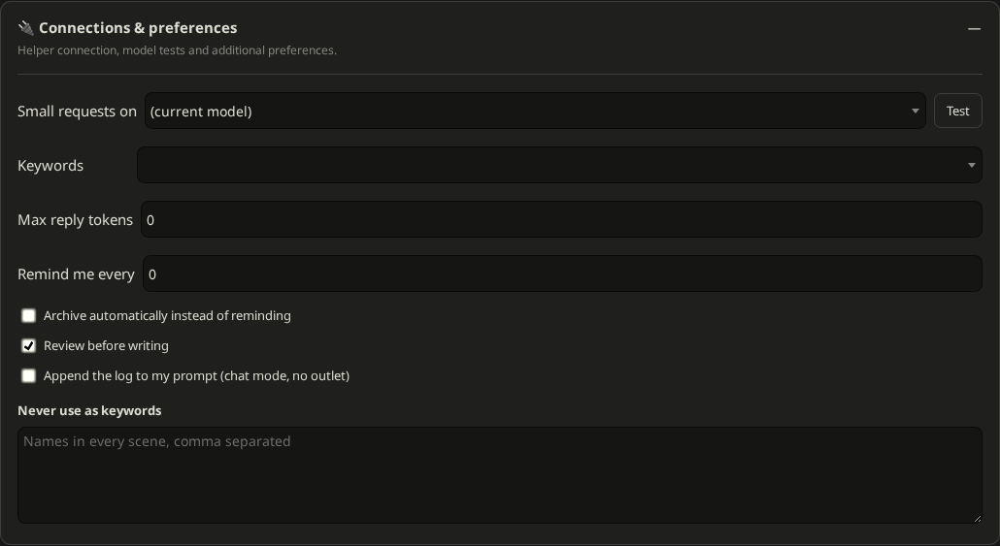

Scene Archivist uses SillyTavern's connections, including compatible proxy configurations. Configure the connection in SillyTavern. **Small requests on** chooses a Connection Manager profile for auxiliary work or uses the **current model**. **Test** makes a small request to check that choice. If the chosen profile fails, the existing fallback uses the current model and shows a warning.

Other controls include:

- **Keywords:** ask the model or use automatic keyword extraction only.
- **Max reply tokens:** cap generation output; `0` uses your preset's response length.
- **Remind me every:** show an archive reminder after the configured message interval; `0` disables reminders.
- **Archive automatically instead of reminding:** run the archive workflow at that interval.
- **Review before writing:** show the archive review before saving.
- **Append the log to my prompt:** include the log in chat mode without an outlet.
- **Never use as keywords:** ignore overly broad terms or names that would activate entries constantly.

AI summaries, memory generation, condensation, diaries, continuity checks, and enabled Recall can make model requests. Tidy and ordinary Library browsing do not. Usage and charges follow the provider and connection you configured.

</details>

### Existing SillyTavern vectors

<details>
<summary>See optional semantic matching</summary>

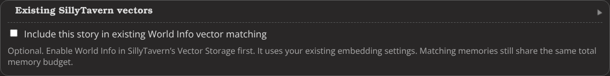

Enable World Info in SillyTavern's **Vector Storage** first, then enable **Include this story in existing World Info vector matching**. This optional bridge reuses your existing embedding configuration; it does not add another embedding connection. Current matching records still pass through the shared memory budget. Availability depends on the native vector integration exposed by your SillyTavern version.

</details>

## Backups and recovery

### Export the whole story or just the workflow

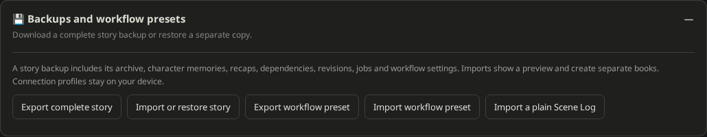

| Action | What it preserves or imports |
| --- | --- |
| **Export complete story** | Managed archive books, character memories, recaps, dependencies, revisions, coverage, jobs, and workflow settings. |
| **Import or restore story** | Preview the book mapping and create restored books while retaining existing books. You can also apply saved workflow settings. |
| **Export / Import workflow preset** | Reuse configuration without moving connection profiles or credentials. |
| **Import a plain Scene Log** | Review and file compatible log text. |

Export a complete story before a large cleanup or migration. Restored records from another chat do not automatically claim its message ranges as evidence from the open chat. Named chat branches get separate managed story books before new writes; inherited evidence is checked against the branch's messages.

Back up your skeletons. The closet is not version control.

### Paused jobs, saved results, and Undo

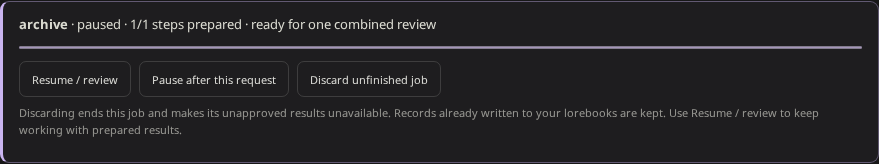

Jobs save generated results before review. If you cancel a review, use **Resume / review** to reopen the retained result. **Pause after this request** stops between requests, **Cancel remaining steps** ends the pending work, and a failed job offers **Retry / review saved result**. A saved usable result can be reviewed again without generating it again.

Accepted stages have completion receipts to help prevent duplicate writes after a reload or partial failure. **Archive thoroughly** retains its remaining memory and tracker stages when paused. If a queued source changed, cancel that job and choose the corrected sources rather than applying old output blindly.

**Undo** restores the last write's books, metadata, and matching message visibility. It is one write, not an unlimited history of the whole session; newly created empty books may remain. For earlier text, open a record's saved revisions. Reviews also check for intervening source/book edits before accepting a write.

## Slash commands

| Command | Action |
| --- | --- |
| `/archivist` | Summarize new material into the selected archive. |
| `/archivist-memories` | Run character memory generation. |
| `/archivist-condense` | Condense long **character memory lists**. Use the Condense tab for selected archive recaps. |
| `/archivist-recap` | Show a short “Previously on...” recap. |

## Troubleshooting

| What you notice | What to check |
| --- | --- |
| A summary exists, but the model seems unaware of it | Check **Attach to chat**, delivery position, and any outlet macro. Inspect **What the model saw**, loading reasons, status, and the token budget. |
| “All up to date” seems wrong | Use **Recheck coverage**, inspect gaps and stale sources, and check whether a memory source-range filter is set. Review or resume any paused job. |
| The console says `finish_reason: 'stop'` | That normally means generation ended. Check the actual response and job status. Empty output or unusable JSON is a different problem; inspect the job error before retrying. |
| A result was canceled during review | Open the saved job's **Resume / review** action. |
| A record cannot be condensed | Check its status and protections. A recap needs at least two eligible sources per batch, and the final recap plus chronology must be smaller. |
| A diary character is missing | They need current memories in this story. Check the memory subject/name and stale status; use the alternate memory name only when needed. |
| No personality entry matches | Put the character's name or proven alias in the selected lorebook entry's title/comment or keywords, choose another lorebook, or leave it empty. |
| A request exceeds the input limit | Reduce the relevant batch size, split an oversized source, or adjust the request input limit to suit the connection's context capacity. |
| The connection test fails | Check the selected Connection Manager profile or current model in SillyTavern, then read the reported request error. |
| You need to report a problem | Include extension and SillyTavern versions, steps to reproduce, the exact error, and relevant diagnostics. Remove private story text or credentials before sharing. |

AI output still needs your judgment. Review the dates, who was present, who learned what, and whether the wording says more than the evidence supports. Scene Archivist keeps the paperwork organized; your questionable fictional life choices remain yours.
