# Scene Archivist 1.2.0

**Your story has consequences. Your characters should remember them.**

Scene Archivist is a continuity and memory extension for **SillyTavern**, made by **Mira**. Save scenes, character memories, trackers, and private diaries as editable lorebook entries. Follow a memory back to the original scene, and keep track of who actually learned the secret.

If your characters can hide a body but cannot remember where they had dinner, we have some filing to do.

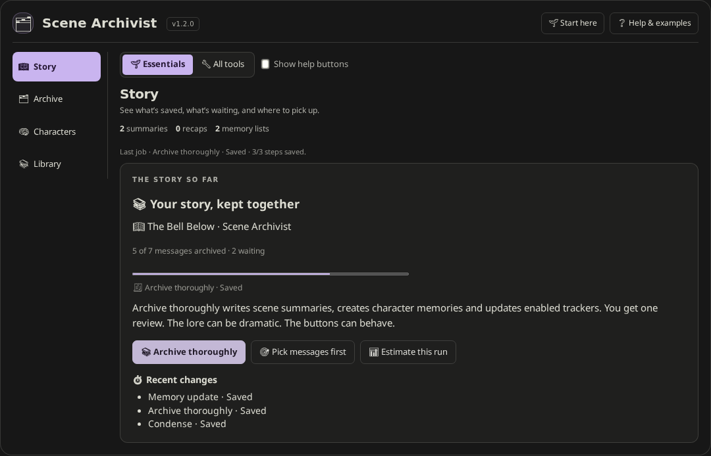

[Install](#install-and-make-your-first-archive) · [Archive thoroughly](#archive-thoroughly) · [Characters](#characters) · [Diaries](#character-diaries) · [Library](#library-and-history) · [Condense](#condense-by-tokens) · [Prompt and recall](#prompt-and-recall) · [Settings](#settings-and-connections) · [Sharing and branches](#sharing-and-branches) · [Recovery](#backups-and-job-recovery) · [Commands](#slash-commands)

The examples use an invented story about a flooded railway station. Screenshots and walkthroughs were captured in **SillyTavern 1.19.0** with scripted model replies and sample lorebooks. Your theme and model output will look different. See the [changelog](CHANGELOG.md) for version history.

## Install and make your first archive

1. In SillyTavern, open **Extensions → Install extension**.
2. Paste [https://github.com/AmiBastian/SillyTavern-SceneArchivist](https://github.com/AmiBastian/SillyTavern-SceneArchivist) and leave the branch field at its default.
3. Reload SillyTavern and open a chat. Open the wand menu and choose **Scene Archivist**.
4. Select a lorebook in **Archive → Your archive**, or use **Start here** to create one and preview a short message range.
5. Pick **Summarize this range** for a summary, or **Archive this range thoroughly** to also create memories and update enabled trackers. Read the review, then save the entries you approve.

For an existing installation, use SillyTavern’s extension update control. Before updating an active story, **All tools → Maintain → Backups and restore → Back up this story** saves its books, coverage, revisions, and unfinished job.

**Essentials** shows Story, Archive, Characters and Library. **All tools** reveals Maintain, Prompt, Settings and the advanced sections. Your picks and unfinished job stay available. **Help & examples** has a quick start, a worked example, and a searchable button guide. Hover or focus an action for its explanation, or turn on **Show help buttons** to open it separately.

Help and mobile view

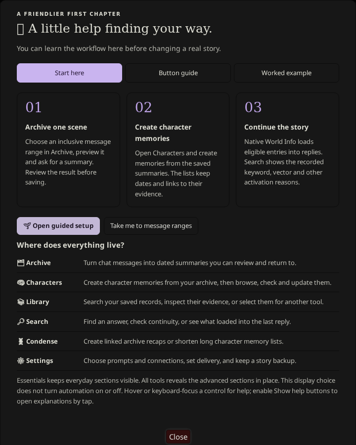

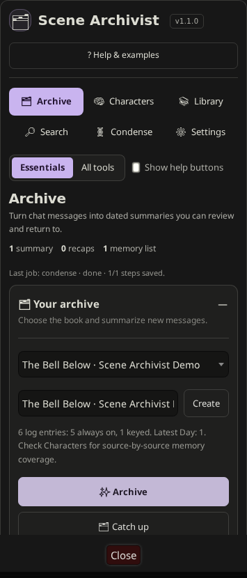

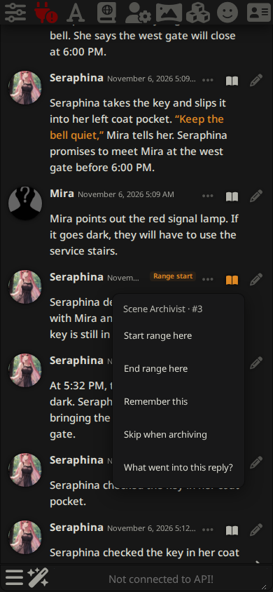

## Archive thoroughly

| Action | What it does |
| --- | --- |
| **Summarize new messages** | Summarizes uncovered messages and creates lorebook keywords in the same request when the input fits. |
| **Archive thoroughly** | Runs archive, memories, and any enabled trackers, followed by one review. |
| **Summarize this range** | Summarizes an inclusive selection. Turn on **Also create memories** to include memory extraction in that job. |
| **Archive this range thoroughly** | Runs the enabled stages for the selected scene. |
| **Preview selected messages** | Shows message excerpts so you can check your selection before sending anything to a model. |

Use the small book icon beside a chat message’s edit controls. Choose **Start range here** on the first message and **End range here** on the last. You can also enter both numbers in **Archive → Pick your messages**. Both endpoints are included, and your picks follow the messages when their numbers change. If an endpoint was deleted, choose it again.

The same menu can **Skip when archiving**, **Remember this**, or open a reply’s memory trail. **Suggest scene breaks** gives you possible end points to pick from. Use the newest-message buffer to keep an unfinished scene out of automatic suggestions. **Estimate this run** previews requests and approximate tokens without contacting the model.

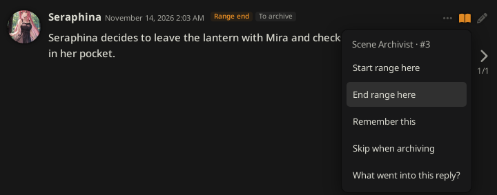

Day, Chapter, Episode, Session, Act, Part, Week, Scene, and custom units are available under **Settings → Prompts**.

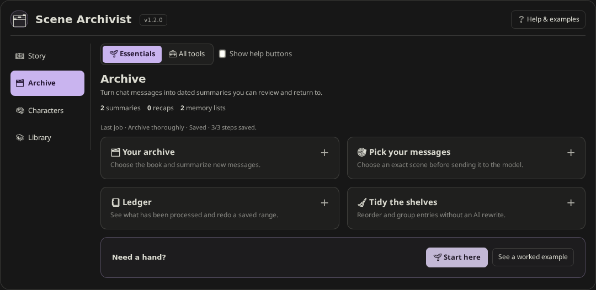

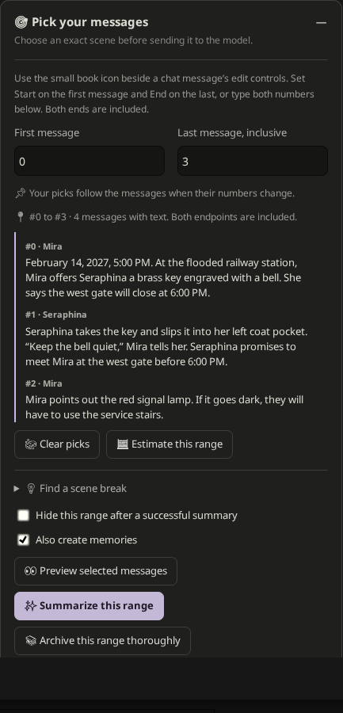

Archive thoroughly normally uses one request per stage, up to three when everything fits. **Settings → Optional automation** can combine stages into one request when they use the same profile. If the context is too small, the job shows the problem and offers an explicit split or retry. Review the prepared entries together and approve the ones you want. **Review later** retains the draft.

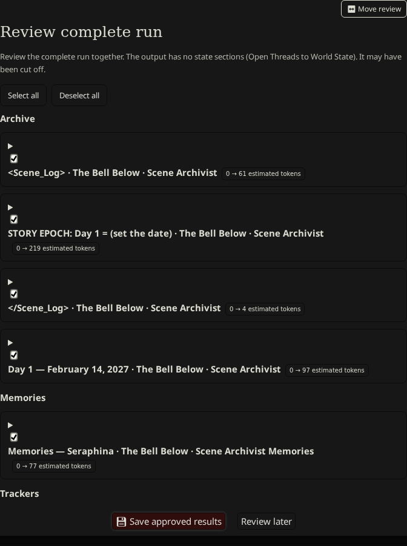

The **Ledger** shows which ranges are covered. Use **Redo summaries** to replace linked summaries from their original messages, or **Mark unprocessed** to make a range available again. **Hide this range** and **Show this range** control the chat’s visibility separately. **Tidy the shelves** reorders saved entries without an AI rewrite.

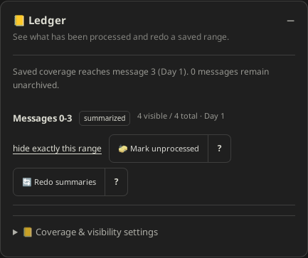

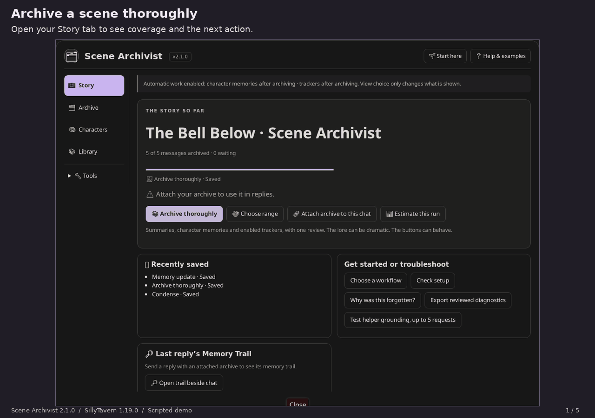

[Watch the range walkthrough in MP4](docs/media/range-walkthrough.mp4)

## Characters

### Create and browse memories

| Read from | What the model reads |
| --- | --- |
| **Chat** | Original messages. You can use it before you create an archive summary. |
| **Archive** | Saved scene summaries. |
| **Both** | Original messages as event evidence, with archive units for chronology and background. |

When you create **Chat** memories before choosing an archive, Scene Archivist creates an archive lorebook to link the story. By default, memories go into a separate lorebook and the archive starts empty.

**Scope** can target new material, exact chat messages, an archive unit range, or the last several units. Use an exact selection to fill a gap even if coverage says the surrounding range was processed. **Create memories for my persona** is available in Settings and starts unchecked.

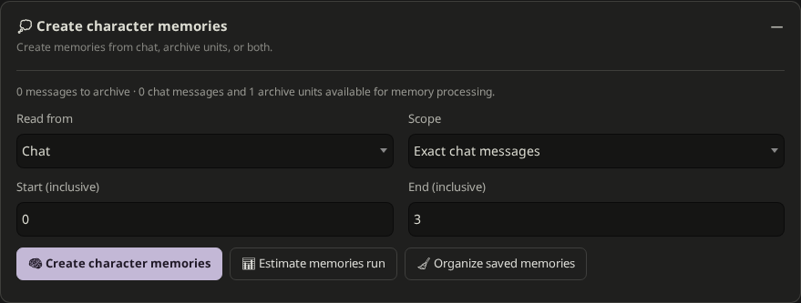

Select a character in the **Character memory browser** to read or search their lists. **AI update…** lets you propose corrections with chat evidence. **Organize saved memories** is a separate reviewed rewrite. Routine generation adds to existing lists and removes exact repeats. Protected lists are reported and the associated sources remain available for extraction.

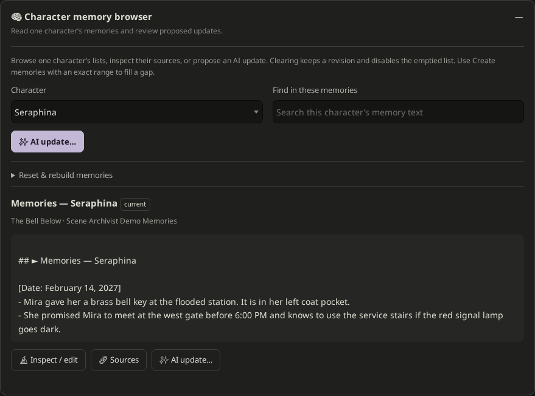

**Character timeline** groups dated memories and opens their evidence. **Export character memories** downloads plain Markdown. **Remember this** on a chat message saves one detail for a chosen character, with optional keywords and a link to that message. The AI polish button is optional.

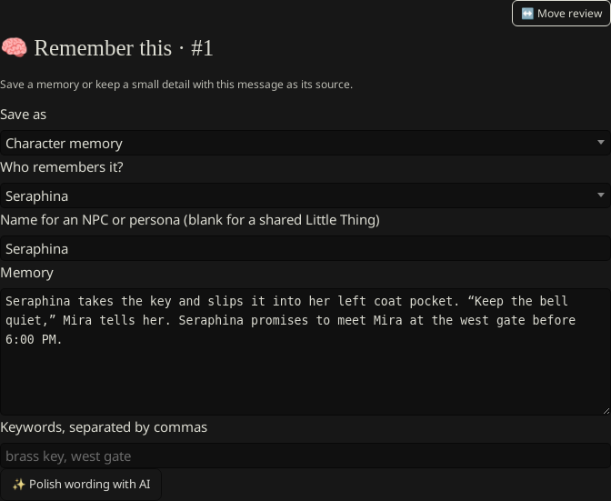

### Trackers, facts, and knowledge

Under **Characters → Trackers**, select a tracker and enable **Keep this one updated**. Use the built-in templates for relationships, promises, secrets, items, or whereabouts, or add your own. **Update all enabled** uses one tracker request when the input fits. Archive thoroughly includes enabled trackers in its final review.

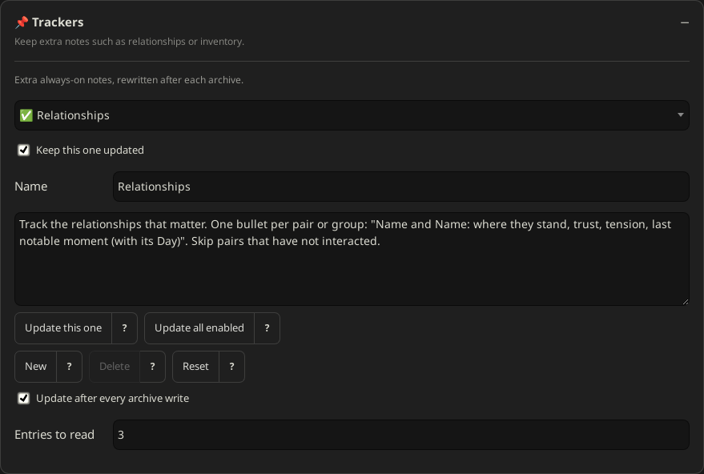

Use **Facts, knowledge and unfinished business** to write or extract who knows, suspects, or is unaware of a fact. **Knowledge as of a date** shows a character’s earlier learning state when one was recorded. The **Character roster** lets you review aliases, merge matching lists, and set destinations. Pin an unresolved thread to give it priority within the memory budget. The recap can know where the body is buried. The cast can keep their secrets.

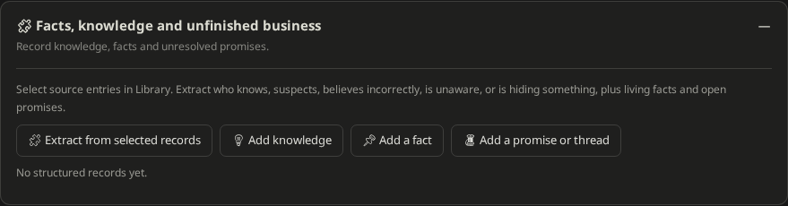

## Character diaries

1. In **Characters → All tools**, open **Character diaries** and select a character. Optionally enter a story date, an inclusive message range, or a style note.
2. Choose **Write a diary**. The model reads original chat messages, the character card, and attached background lore. Review the first-person text before saving.
3. After the story continues, choose **Update diary from new chat**. The previous diary provides voice and continuity, and later messages supply the new events. An exact range lets you revisit an earlier scene.
4. Use **Condense diary** when the saved text grows too large. The previous version remains in Library history.

Diaries are saved to the archive separately from active character memories. You can find them with the **diary** type filter in Library.

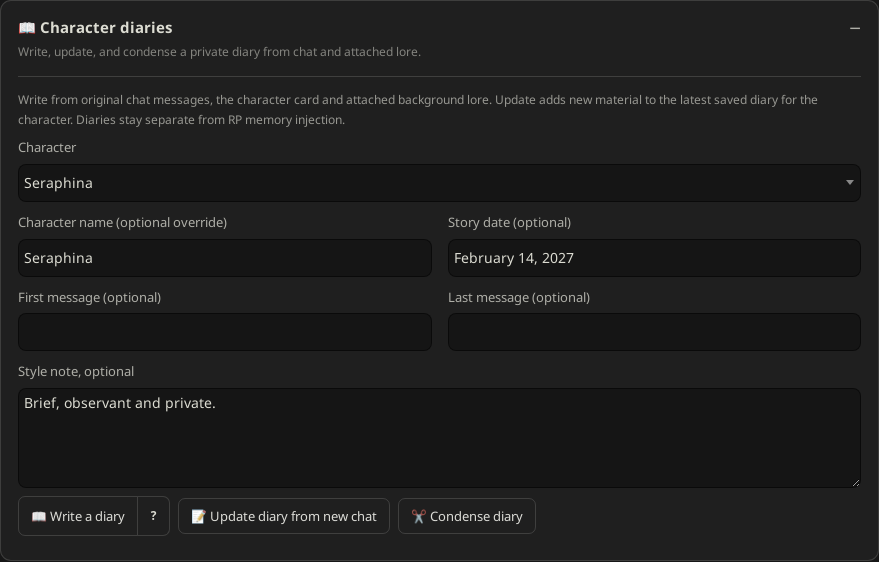

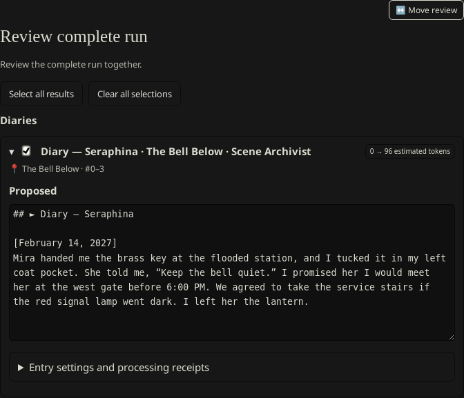

Updating and finding a saved diary

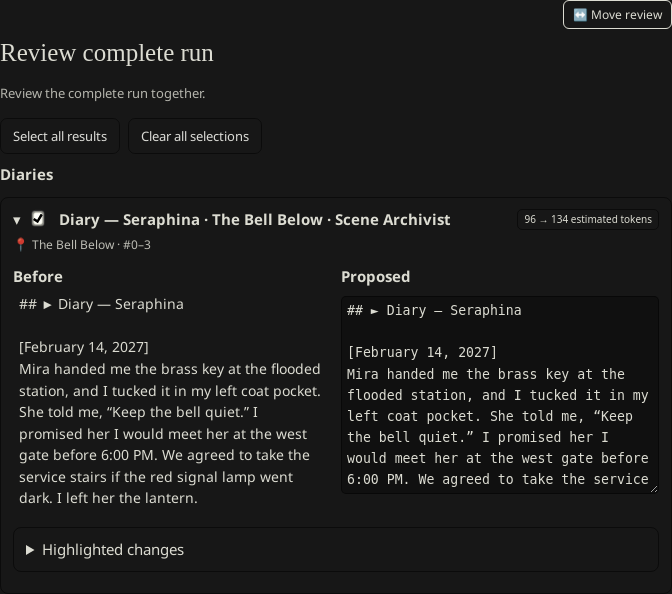

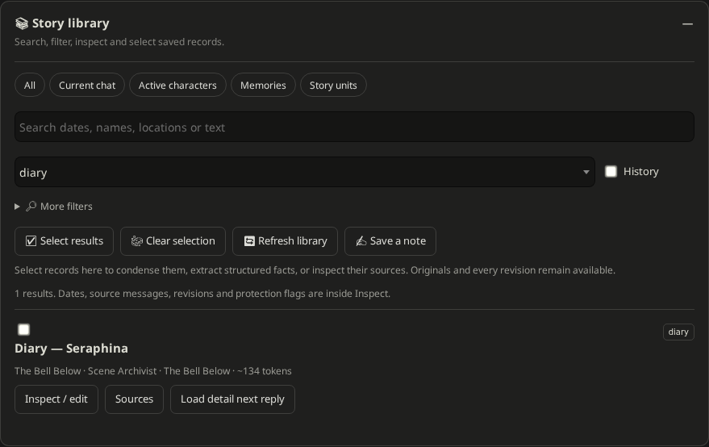

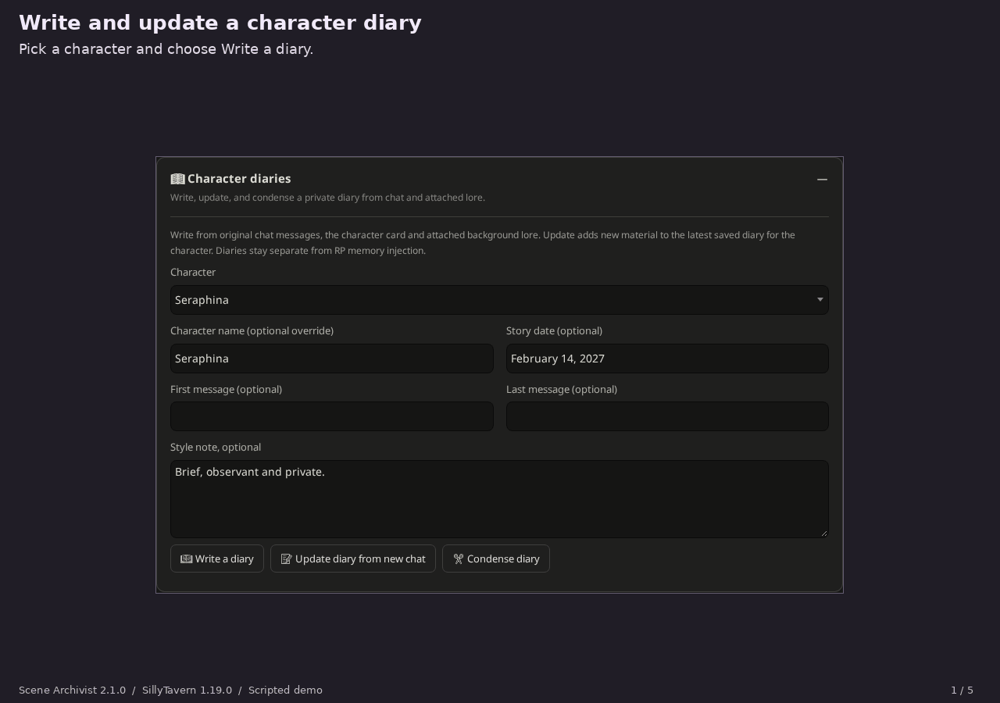

[Watch the diary walkthrough in MP4](docs/media/diary-walkthrough.mp4)

## Library and history

Use **Library** to search saved entries by text, date, character, location, or record type. **Inspect** shows the text, original message ranges, linked sources, earlier revisions, and protection controls. Turn on **History** to include retired records. Use **Save a note** to keep an author note without making a model request.

- **Author locked**, **Preserve exact wording**, and **Keep detailed** protect deliberate wording from automated rewrites.
- **Prioritize in memory budget** gives an eligible record preference when Scene Archivist trims loaded entries.
- **Exclude this record from injection** keeps it in the book for reference without including it in prompts.
- A source edit is shown beside a proposal when relevant. Existing saved memories remain available after ordinary chat edits, and you can approve prepared work without rebuilding an existing list first.

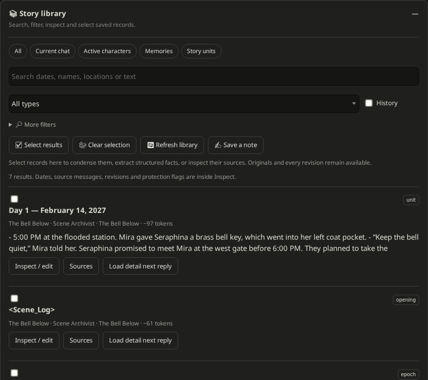

Trace a record to its original messages

Use **Sources** on a Library result. Each source range lists the chat it came from and links to the messages that are still available. A linked recap can lead back to its full original units.

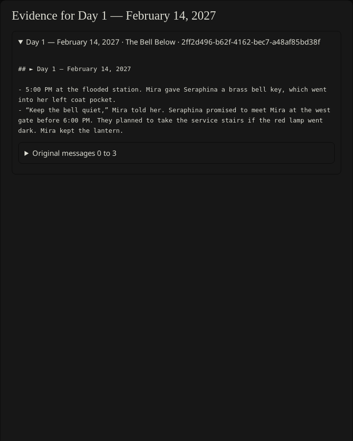

## Condense by tokens

| What you want shorter | What to choose |
| --- | --- |
| A Day, Chapter, or other archive unit | Select it in **Library**, then choose **Maintain → Condense story records → Shorten individual entries**. |
| A stretch of older units | Select the units in **Library** and choose **Create recap**. The recap keeps links to the full original entries. |
| A character’s memory list | Use **Condense character memories**. Select or protect lists in Library as needed. |
| A saved diary | Choose the character and use **Condense diary**. |

Set a flexible **Token target**, or use **0** for the shortest faithful version. You can keep the same number of entries or memory bullets and still save tokens by tightening their wording. The result checks preserve required headings, dates, times, and exact quotations. Review the diff for decisions, relationship shifts, promises, clues, and other details that matter to your story.

Optional recap automation can suggest or create a recap after newer units, fictional time, or archive token pressure. Choose the automation setting before relying on it. Protected records keep their detailed text.

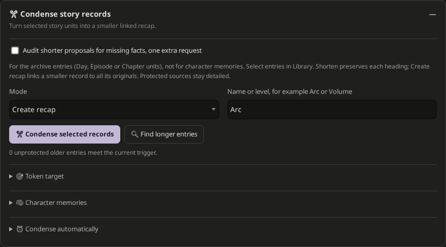

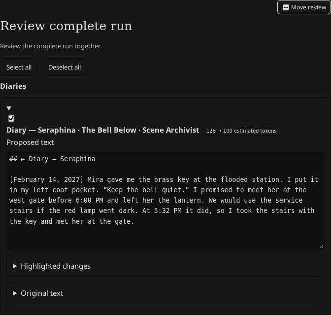

## Prompt and recall

- Under **Library → Search, evidence and continuity**, **Ask the archive** answers a question with source links. **Check this claim** checks one statement, and the recent or whole-archive checks look for conflicts across records.
- **Previously on…** creates a short return recap for the reader. **Recall** can ask a helper model to pick relevant details before a normal reply.
- In **Prompt**, **View last reply’s memory trail** and **Memory budget and loading reasons** show which Scene Archivist entries loaded at SillyTavern’s World Info stage, which were skipped, and why. The message menu opens the trail for that reply or swipe. The trace keeps counts, titles and source links for recent replies.

In groups, Scene Archivist loads only the speaking card’s memories by default. Use **Remember this** to choose the exact card when two cards share a name. You can change group memory scope in Prompt. Saving a group memory for a uniquely identified card also gives its lorebook entry a SillyTavern character filter. Existing entries get that filter when edited or regenerated in the group. Filters set by hand in World Info are preserved.

**Cache-friendly delivery** is optional. It puts fixed lore earlier and changing matches near the reply. The memory trail reports an approximate shared prompt prefix between requests. Provider caching depends on the connection. **On-demand memory tools** are experimental and opt-in. They require a tool-capable Chat Completion connection with Function Calling enabled and may add another request.

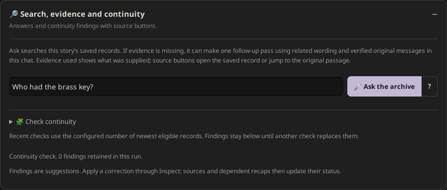

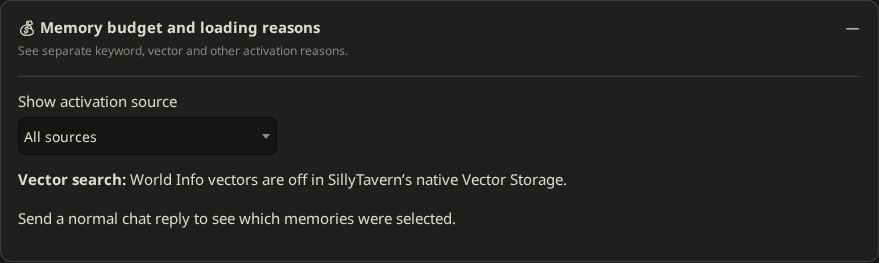

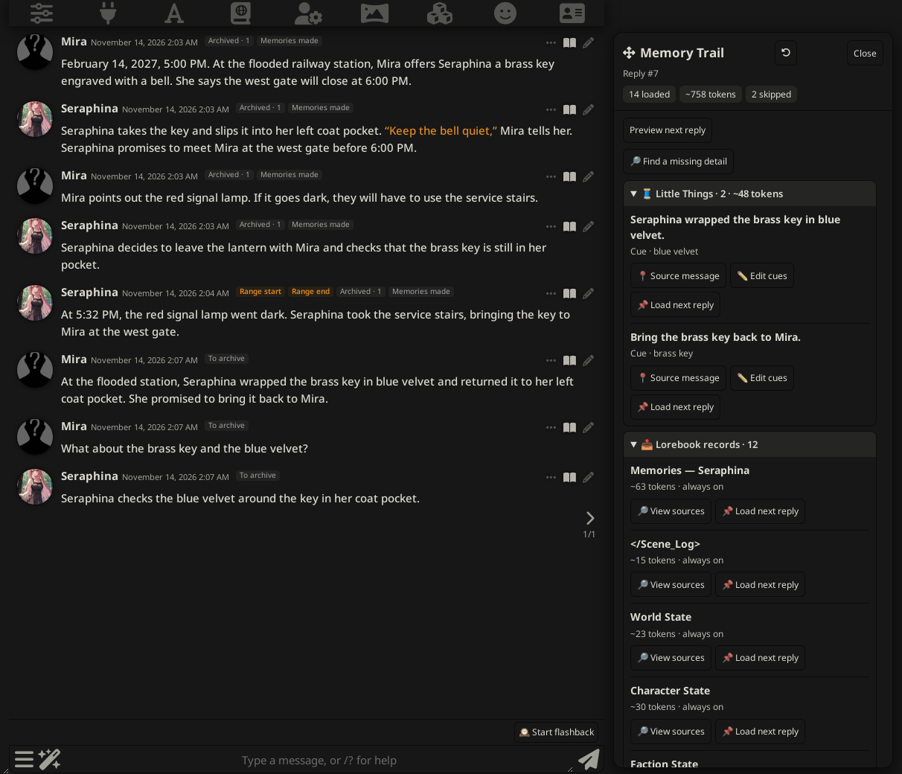

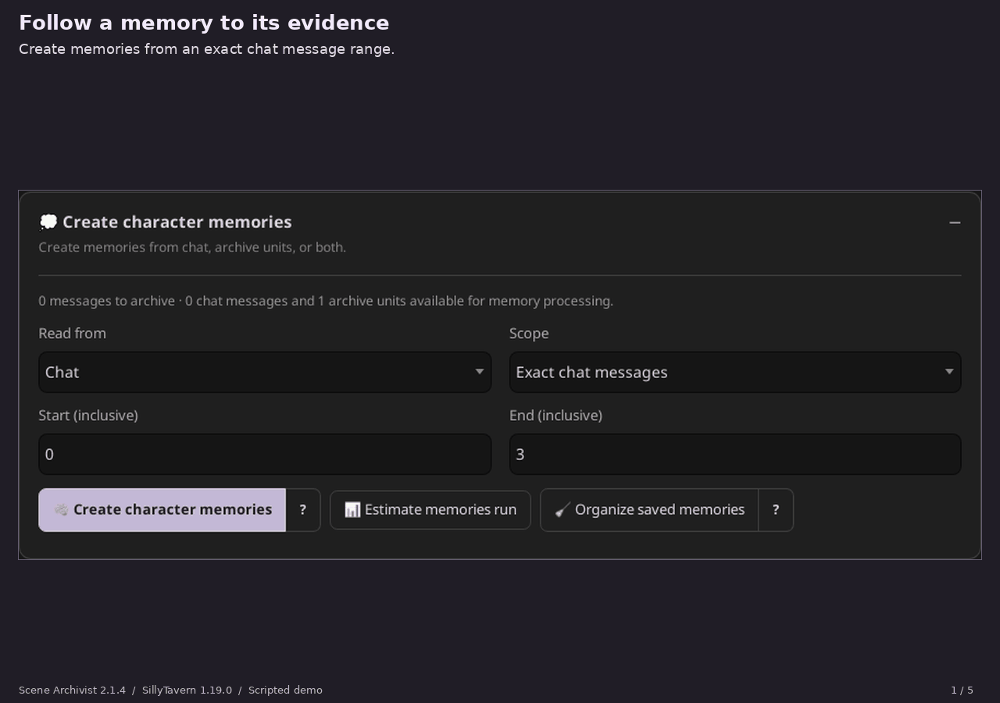

[Watch the evidence walkthrough in MP4](docs/media/evidence-walkthrough.mp4)

## Settings and connections

| Setting | What it controls |
| --- | --- |
| **Archive model** | Connection profile for summary and keyword generation. |
| **Memory and tracker model** | Connection profile for memory, tracker, and diary jobs. |
| **Create memories for my persona** | Includes your played character as a memory subject. Starts off. |
| **Read selected lorebooks for archive and memories** | Includes chosen lorebooks or individual entries as background. Starts off. |
| **Include SillyTavern chat context** | Uses the assembled prompt preview. Starts off. Extensions that inject only during live generation can supply different material. |
| **Prepare rolling memories from chat** | Prepares a review after a chosen number of new messages, with a buffer for the most recent ones. Starts off. |

**Check setup** checks the archive attachment, delivery, budget and optional integrations. Its model test buttons each send one short request on the named connection. **Manage workflow profiles** saves prompts, budgets and delivery for this chat, character or group. Chat profiles take precedence over character and group profiles. Connection profiles are configured separately.

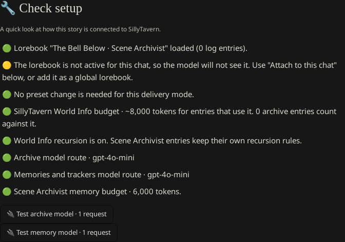

**Current SillyTavern model** uses your live connection. A failed profile can be retried directly, or you can explicitly select **Use current model**. Context checks use the capacity exposed by the configured connection. Custom proxies can apply additional limits.

Helper tools such as memory organization and archive search use the helper model’s context with room reserved for the reply. In **Story memory settings**, leave the helper input and count limits at **0** to fit the connection automatically. Set a positive limit to cap a request. If a connection exposes no context size, the automatic helper input estimate is 18,000 tokens.

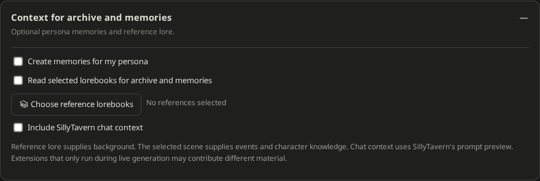

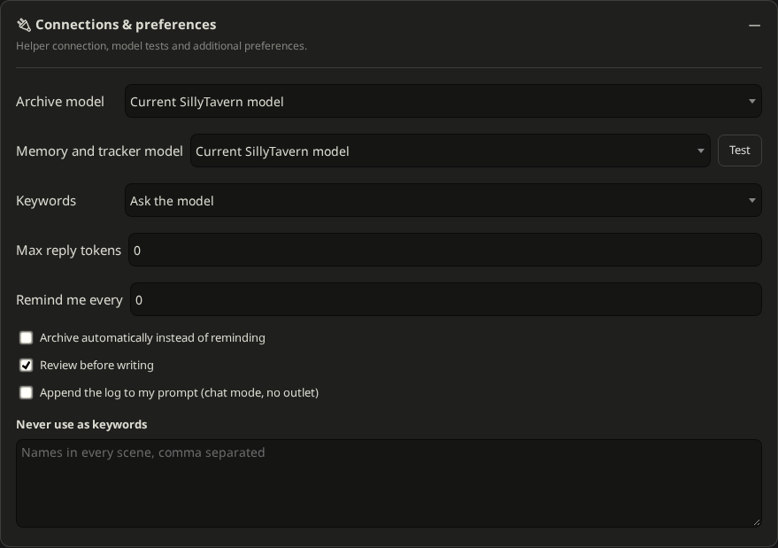

Automation, prompts, and lorebook delivery

**Optional automation** also contains the single-request mode. **Prompts** is where you choose story units and edit prompt presets. **Prompt → Delivery** controls how eligible entries are placed in the prompt. If you use an outlet, add its macro to the relevant preset or prompt.

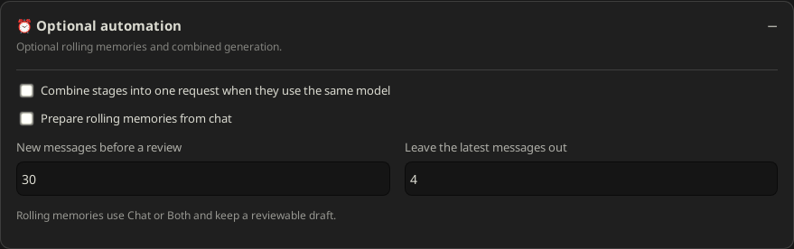

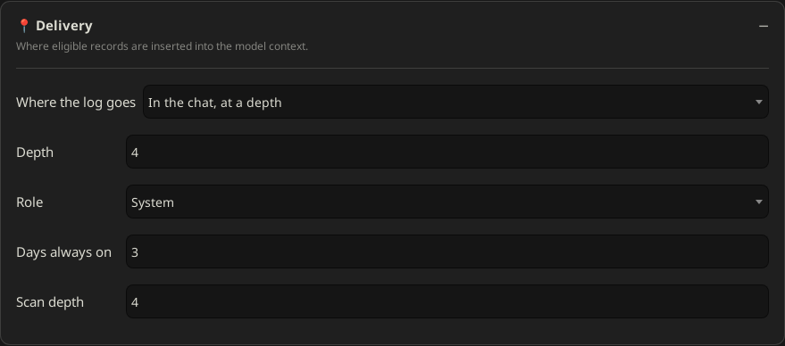

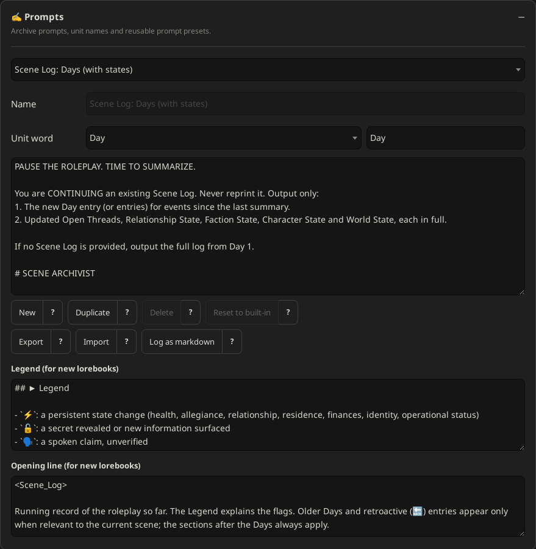

## Sharing and branches

Open **Maintain → Archive sharing** and enable **Share this archive across chats** in the original chat, then select that book in the other chat. This is for chats that intentionally share one timeline. **Where to file new summaries** can start a new unit, continue an existing unit, or file an earlier event. Each contribution keeps its own source range. Use one writer at a time when updating a shared archive.

Open **All tools → Maintain → Branches** to choose verified earlier history or empty private books. To create the branch, open the original message’s three-dot menu in SillyTavern and choose **Create Branch**. The branch view shows the parent and fork point when available. Later records stay in the parent when the extension cannot verify them as part of the branch.

Renaming a chat in SillyTavern keeps its archive and progress. A native branch or a separate copy of the original chat file gets private books, even when the copied file has the same internal identifier. Use SillyTavern’s **Branch** action to keep lineage easy to follow.

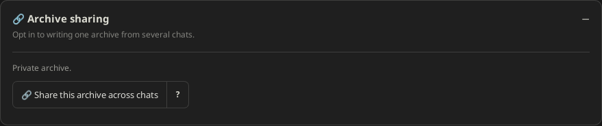

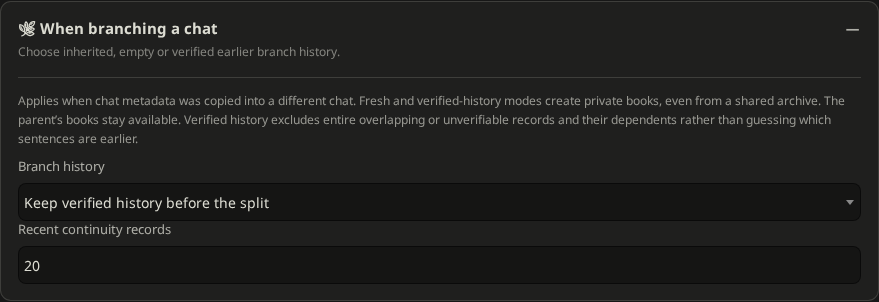

## Backups and job recovery

**Back up this story** includes books, original source links, revisions, settings, and the unfinished job. **Restore a story backup** previews the import and creates separate books. The historical draft remains available in the backup. Start a fresh run in the restored destination. Workflow presets transfer settings separately from story content. **Copy from another lorebook** lets you review and copy one entry as a clip. Check setup flags possible overlapping memory extensions or books.

If a later stage fails, choose **Review ready results** to save completed work, then **Retry failed stage**. A canceled review can be reopened through the saved job. **Discard unfinished job** clears its pending proposals. **Undo** checks what was written and preserves newer edits it cannot safely reverse.

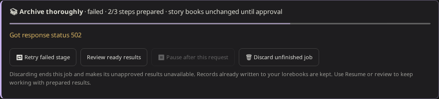

Review prepared work and keep a backup

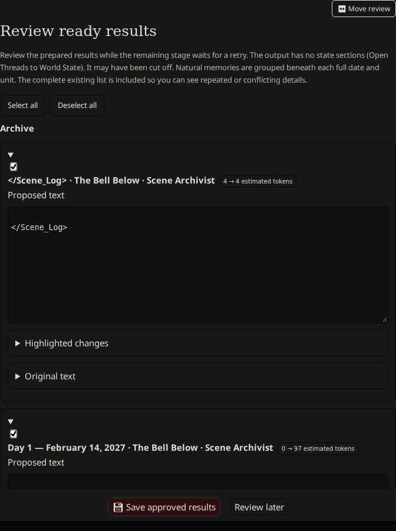

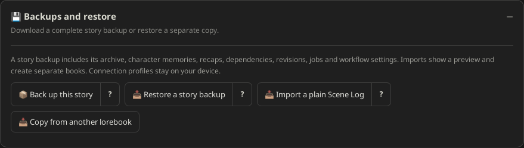

## Slash commands

| Command | Action |
| --- | --- |
| `/archivist` | Summarize new material into the selected archive. |
| `/archivist-memories` | Create character memories using the configured source and scope. |
| `/archivist-condense` | Condense character memory lists. |
| `/archivist-recap` | Show a “Previously on…” recap. |

## Troubleshooting

| What you see | What to check |
| --- | --- |
| The model seems unaware of a saved summary | Check **Attach to chat**, delivery position, and any outlet macro. Open **Prompt** or the reply’s memory trail to inspect loading and budget. |
| Memories skip part of the story | Set **Read from** to **Chat** or **Both** and select the exact missing messages. For archive-only work, use a unit range or **Last X units**. |
| A request exceeds the context | Choose a larger context on the selected connection, shorten the selection, or explicitly split the failed stage. |
| A generated entry will not condense | Check its protection flags and the review’s token estimate. A shorter version must preserve the required chronology and quotations. |
| A diary does not update | Check that the character has a saved diary and that later messages exist. An exact range can cover an earlier scene. |
| You need to report a problem | Include the Scene Archivist and SillyTavern versions, steps to reproduce, and the exact error. Keep private story text and credentials out of the report. |

## Credits

For [1.1.0](CHANGELOG.md#110--november-5-2026), thanks to **Mimo433** for sharing a patch for the memory approval deadlock. Scene Archivist’s fix was developed independently. Thanks to everyone who tested ranges, retries and actual long chats and reported where the interface got in the way.

## License

Scene Archivist is available under the [GNU General Public License v3.0](LICENSE).
